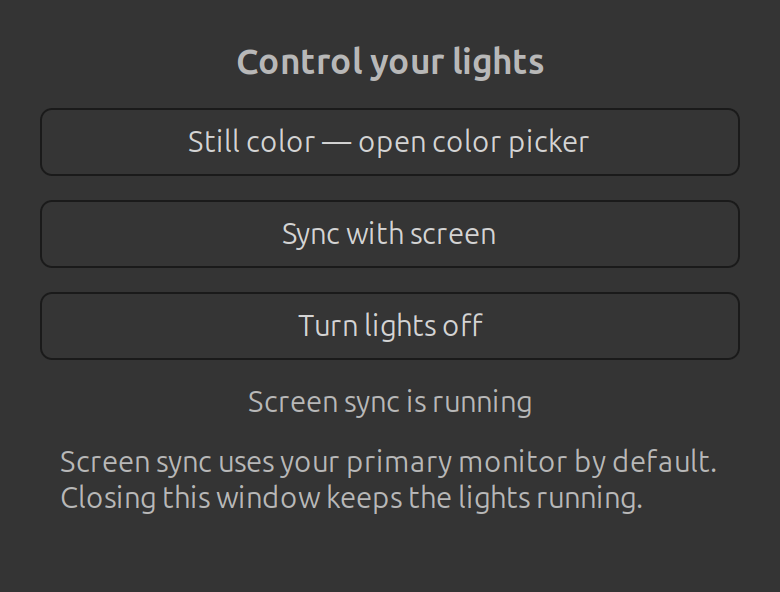

# DX Light Panel

A small native Linux window for choosing **still color**, **screen sync**, or
**off** on a ROBOBLOQ / DX-Light USB LED controller. No Wine required.



This panel switches between two existing controller programs. It provides the
mode UI, application-menu launcher, and exclusive ownership of the USB device;
the upstream programs provide color selection and screen capture.

## Tested hardware

Tested on Ubuntu 24.04, GNOME **X11**, with a 4K display and this controller:

| Field | Value |
| --- | --- |
| USB vendor/product ID | `1a86:fe07` |
| Manufacturer | `ROBOBLOQ` |
| Product | `USBHID` |
| Working layout | 65 LEDs: 31 top + 17 left + 17 right |

The owner confirmed whole-strip color control, screen sync, and mode switching
on physical hardware. This does **not** establish compatibility with every
DX-Light-branded product. The commercial model number is unknown. Other LED
counts require work: the upstream color picker currently hardcodes 65 LEDs.
Screen-edge ordering has not been separately calibrated. Music sync is not
included. Screen sync currently requires X11; Wayland is not supported here.

## Install (Ubuntu / Debian)

Run as your normal desktop user. A working systemd user session is required.

1. Install system packages:

   ```sh
   sudo apt install git build-essential cmake pkg-config libhidapi-dev \
     libgtkmm-3.0-dev python3-gi gir1.2-gtk-3.0 util-linux
   ```

2. Install a current stable Rust toolchain (`cargo` and `rustc`) using the
   [official Rust instructions](https://www.rust-lang.org/tools/install).

3. Clone this project and grant the active desktop user access to this device:

   ```sh
   git clone https://github.com/adamamer20/dx-light-panel.git
   cd dx-light-panel
   sudo install -m 0644 70-dx-light.rules /etc/udev/rules.d/70-dx-light.rules
   sudo udevadm control --reload-rules
   ```

   Unplug and reconnect the controller. The rule targets only `1a86:fe07` and
   uses the active-seat ACL; it does not make all HID devices world-writable.

4. Build and install:

   ```sh
   ./install.sh
   ```

   This downloads fixed upstream revisions, builds them locally, and installs
   the panel and two systemd user services. It stops existing DX Light modes
   before replacing their files, preserves an existing screen-sync configuration,
   and does not enable login autostart. Network access is needed for installation;
   runtime control is local.

5. Open **DX Light** from the application menu, or run:

   ```sh
   ~/.local/bin/dx-light
   ```

## Use

- **Still color** opens the native color picker with a brightness slider.
- **Sync with screen** follows the primary X11 monitor at 30 FPS by default.
- **Turn lights off** stops both modes and sends a black frame.
- Closing the panel keeps the selected controller running. Closing the color
  picker leaves its last color on the strip.

Switching modes stops the previous controller before starting another. Commands
are serialized and the services also declare mutual conflicts and ordering.

CLI equivalents:

```sh
~/.local/bin/dx-light color
~/.local/bin/dx-light sync
~/.local/bin/dx-light off
~/.local/bin/dx-light status
```

Screen-sync settings are in `~/.config/dx-light-panel/sync.toml` (or under your
`XDG_CONFIG_HOME`). To choose another monitor:

```sh
~/.local/share/dx-light-panel/backends/quiklight --list-monitors
```

Add `monitor = "DP-1"` with the reported name, then apply settings:

```sh
systemctl --user restart dx-light-sync.service
```

Do not run the original Wine app or other LED controllers simultaneously.

## Troubleshooting

Check USB detection with `lsusb -d 1a86:fe07`. Check the logs with:

```sh
journalctl --user -u dx-light-color.service -u dx-light-sync.service -n 50
```

If access is denied, reconnect after installing the udev rule. If screen capture
fails, verify `echo "$XDG_SESSION_TYPE"` prints `x11`. Launch the panel from your
desktop session so it can pass the current display credentials to systemd.

## Uninstall

```sh
~/.local/bin/dx-light off
systemctl --user stop dx-light-color.service dx-light-sync.service
rm ~/.config/systemd/user/dx-light-color.service ~/.config/systemd/user/dx-light-sync.service
rm ~/.local/bin/dx-light ~/.local/share/applications/dx-light-linux.desktop
rm -r ~/.local/share/dx-light-panel
systemctl --user daemon-reload
sudo rm /etc/udev/rules.d/70-dx-light.rules
sudo udevadm control --reload-rules
```

Adjust paths if using XDG overrides. Configuration is retained. Build caches are
in `~/.cache/dx-light-panel`; remove that specific directory if no longer needed.
Other upstream installations are left alone.

## License and credits

The original panel, launcher, installer, configuration, and documentation in
**this repository** are [MIT licensed](LICENSE).

The separately downloaded upstream programs retain their own terms:

- [Hedriel/rgb-controller](https://github.com/Hedriel/rgb-controller), revision
  `b10c3dc3df8cc3a28cd3146803d3df2d93c0332a`: **GPL-3.0**. It descends from
  [shim80/hypr-quicklight](https://github.com/shim80/hypr-quicklight).
- [Kevinsillo/quiklight-x11](https://github.com/Kevinsillo/quiklight-x11), revision
  `85c650c7220d6bd647b919e5c300b667b3259680`: its README declares **MIT**, but that
  revision has no standalone LICENSE file.

This repository includes neither their source code nor their binaries and does
not relicense them. It invokes them as separate programs through their existing
interfaces. It is an unofficial community tool, unaffiliated with ROBOBLOQ or
DX-Light.
